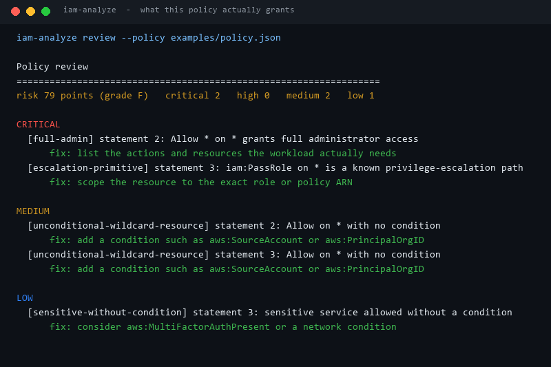
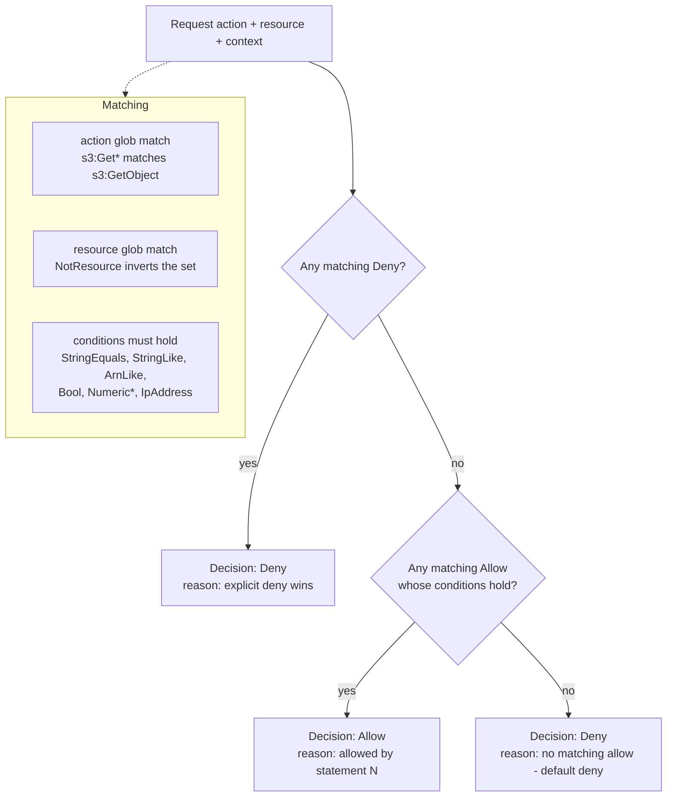
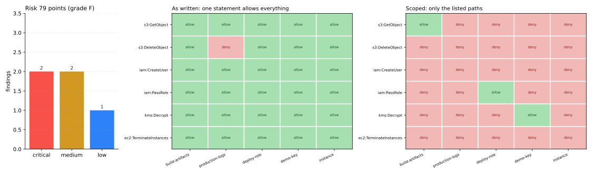

# IAM-Policy-Analyzer

**Answer two questions about an AWS IAM policy without touching AWS:** *what does it actually grant for this exact request*, and *how dangerous is the document as written?*



The review above is the real output of `iam-analyze review --policy examples/policy.json`. Nothing was edited for the screenshot.

---

## Table of contents

- [Why this exists](#why-this-exists)
- [How a request is evaluated](#how-a-request-is-evaluated)
- [The five rules and what they catch](#the-five-rules-and-what-they-catch)
- [Before and after: 30 decisions from 2 policies](#before-and-after-30-decisions-from-2-policies)
- [The uncomfortable batch result](#the-uncomfortable-batch-result)
- [Install and run](#install-and-run)
- [Commands](#commands)
- [Exit codes](#exit-codes)
- [Example files](#example-files)
- [Design notes and limits](#design-notes-and-limits)
- [Tests](#tests)
- [License](#license)

---

## Why this exists

IAM policies are declarative JSON that nobody can read at a glance. Three things routinely
go wrong and all three are invisible in review:

1. **A wildcard buries every other statement.** Once `Allow * on *` exists, every other
   statement in the document is decoration - the policy is administrator access no matter how
   carefully the rest is scoped.
2. **Conditions look like restrictions but are not.** A policy that says "allow only from the
   corporate range" is still all-powerful when evaluated with a request that has no
   `aws:SourceIp` in context, because the *statement* matched and the condition was never
   checked for feasibility.
3. **Deny is easy to get wrong.** An explicit `Deny` beats every `Allow`, and the default is
   deny. Reviewers flip the two constantly.

This tool evaluates requests locally (no AWS calls, no credentials, no network) and prints a
review with a severity per finding, a risk score, and a letter grade.

## How a request is evaluated



The order is the AWS order: **explicit deny, then allow, then implicit deny**. `NotAction`
and `NotResource` are normalised into positive sets at parse time, so the evaluator only ever
has to do one kind of match.

## The five rules and what they catch

| Severity | Code | Trigger | Points |
| --- | --- | --- | ---: |
| 🔴 critical | `full-admin` | `Allow *` on `*` | 30 |
| 🔴 critical | `escalation-primitive` | an action like `iam:PassRole`, `iam:CreatePolicyVersion`, `sts:AssumeRole` on `*` | 30 |
| 🟠 high | `service-wildcard` | `Allow s3:*` on `*` (wildcard service, wildcard resource) | 15 |
| 🟠 high | `not-action` | any `NotAction` - it allows everything the author forgot to exclude | 15 |
| 🟡 medium | `unconditional-wildcard-resource` | `Allow` on `*` with no condition at all | 8 |
| 🟡 medium | `not-resource` | `NotResource` in an `Allow` statement | 8 |
| 🟡 medium | `empty-policy` | no statements | 8 |
| ⚪ low | `sensitive-without-condition` | `iam`, `kms`, `sts`, `secretsmanager`, `organizations` allowed with no condition | 3 |
| ⚪ low | `unknown-version` | `Version` is not `2012-10-17` | 3 |

Grade thresholds: `A` = 0, `B` ≤ 10, `C` ≤ 30, `D` ≤ 60, `F` > 60 points.

A statement that is already `full-admin` is not also reported as `escalation-primitive`.
Listing fourteen escalation primitives that a single `*` happens to cover buries the one
finding that matters - the whole policy is already administrator access.

## Before and after: 30 decisions from 2 policies

Each cell is one request (`6 actions × 5 resources`) evaluated with the same context
(`aws:SourceIp`, `aws:PrincipalOrgID`, `iam:PassedToService` all set to values that satisfy the
hardened policy's conditions - the *most favourable* context it will ever see).



| | As written (`examples/policy.json`) | Scoped (`examples/policy-hardened.json`) |
| --- | ---: | ---: |
| Allowed decisions out of 30 | **29** | **3** |
| Risk score | 79 (grade **F**) | 0 (grade **A**) |
| Findings | 2 critical, 2 medium, 1 low | none |

The single deny in the left panel is the only statement that was not a wildcard
(`Deny s3:DeleteObject` on `production-*/*`). Everything else - creating IAM users, passing
roles, terminating instances - is allowed because one statement says `Allow * on *`.

In the right panel only three requests survive: reading a build artifact, passing the one
deploy role to ECS, and decrypting the one KMS key from the corporate range.

## The uncomfortable batch result

`examples/requests.jsonl` lists seven requests with the outcome the *workload* wants. Running
the same file against both policies:

```
$ iam-analyze batch --policy examples/policy.json --requests examples/requests.jsonl
requests 7   allowed 6   denied 1   mismatches 0

$ iam-analyze batch --policy examples/policy-hardened.json --requests examples/requests.jsonl
requests 7   allowed 1   denied 6   mismatches 5
```

**The over-permissive policy passes 7/7. The least-privilege policy passes 2/7.**

That is the point of the tool. An expected-outcome test suite encodes what the workload
*wants*, not what it *should* have. A wildcard policy will always satisfy those tests, which
is why policies rot towards `*` and why the review pass has to exist separately. The batch
command is for regression-testing a policy change; the review command is for judging the
policy itself.

## Install and run

Standard library only - no third-party runtime dependency.

```bash
python -m pip install -e ".[dev]"     # or just run from the repo with PYTHONPATH=src
iam-analyze --version
```

From a checkout without installing:

```bash
PYTHONPATH=src python -m iam_policy_analyzer review --policy examples/policy.json
```

## Commands

### `review` - score a document

```bash
iam-analyze review --policy examples/policy.json [--format text|markdown|json] [--fail-on high]
```

`--fail-on` defaults to `high`, so a CI step fails on critical and high findings only. Use
`--fail-on never` to always pass. `--format markdown` emits a table suitable for a PR comment.

### `check` - evaluate one request

```bash
iam-analyze check --policy examples/policy-hardened.json \
  --action s3:GetObject \
  --resource arn:aws:s3:::build-artifacts/app.zip \
  --context aws:PrincipalOrgID=o-example
```

```
Request: s3:GetObject on arn:aws:s3:::build-artifacts/app.zip
==================================================================
effect      Allow
reason      allowed by statement 1
allows      1
```

### `batch` - check a JSONL list of requests

```bash
iam-analyze batch --policy examples/policy.json --requests examples/requests.jsonl
```

Each line is `{"action", "resource", "context"?, "expect"?}`. Blank lines and `#` comments are
skipped; line numbers are reported for malformed entries.

### `matrix` - a whole grid of decisions at once

```bash
iam-analyze matrix --policy examples/policy.json \
  --actions s3:GetObject,iam:CreateUser,kms:Decrypt \
  --resources "arn:aws:s3:::build-artifacts/app.zip,arn:aws:kms:eu-west-1:111122223333:key/demo-key"
```

Columns are printed as `R1..Rn` with a legend underneath, because truncating full ARNs to
terminal width makes two different resources look identical.

### `statements` and `validate`

```bash
iam-analyze statements --policy examples/policy.json   # readable per-statement summary
iam-analyze validate  --policy examples/policy.json    # parse + count, exit 2 on bad input
```

## Exit codes

| Code | Meaning |
| ---: | --- |
| 0 | success; for `check`, the request was allowed; for `review`, nothing at or above `--fail-on` |
| 1 | `check`/`batch` denies (or a mismatch); `review` found something at or above `--fail-on` |
| 2 | usage error, unreadable file, or invalid policy |

## Example files

| File | Purpose | Review result |
| --- | --- | ---: |
| `examples/policy.json` | one wildcard statement plus three carefully scoped ones - the most common real-world shape | 79 / F |
| `examples/policy-hardened.json` | the same workload rewritten to least privilege | 0 / A |
| `examples/requests.jsonl` | seven expected-outcome requests used by `batch` | 7/7 vs 2/7 |

No credentials, account IDs beyond the reserved `111122223333` documentation value, or keys
appear anywhere in this repository.

## Design notes and limits

- **Conditions are evaluated, not proved.** `IpAddress`, `StringEquals`, `StringLike`,
  `ArnLike`, `Bool`, `NumericLessThan`, `NumericGreaterThan` and their `Not*` forms are
  checked against the supplied context. If a key is absent from the context the condition is
  treated as not satisfied. The tool never claims a condition is *unreachable* - that is a
  much harder satisfiability problem, and claiming it would be a lie.
- **`NotPrincipal` is parsed but not used in matching.** It is rare and its semantics with
  `Allow` are subtle; the review flags the statement instead of guessing.
- **Scores are weights, not risk estimates.** 30/15/8/3 are chosen so that one wildcard
  statement cannot be diluted by twenty tidy ones. They are not calibrated against incident
  data.
- **Nothing is sent anywhere.** No network calls, no telemetry, no boto3 import.

## Tests

```bash
PYTHONPATH=src python -m pytest -q     # 62 passed
python -m ruff check .                 # All checks passed!
```

62 tests cover glob matching, `NotAction`/`NotResource` normalisation, deny-overrides-allow,
every supported condition operator, all five review rules, all three report formats, every
sub-command's exit code, and a guard that the hardened example scores `A` while the
as-written example scores `F`.

## License

MIT. See [LICENSE](LICENSE).

---

<sub>All screenshots and charts in this README are generated by `scripts/render_assets.py` from
this repository's own output - no stock images, nothing copied from elsewhere.</sub>
